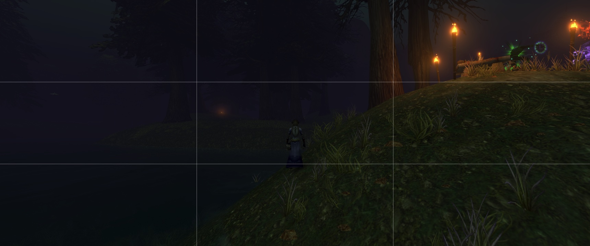
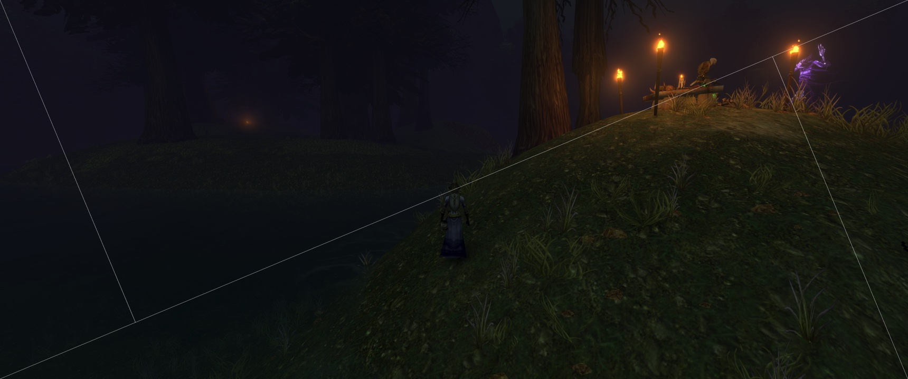
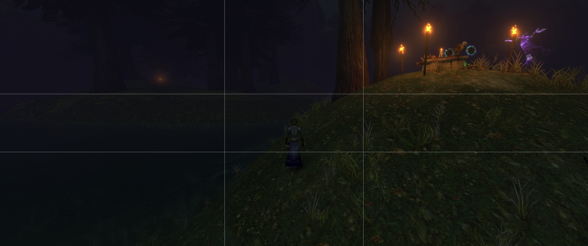
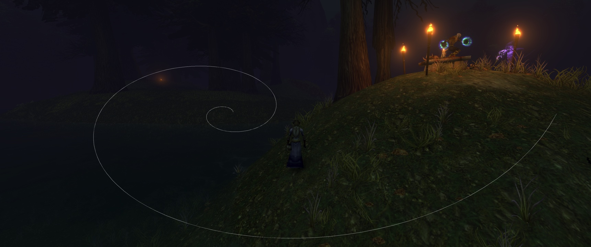

# Azeroth Stillframe 0.4.2

Capture the world, not the interface. Pure WoW: Forever photography add-on.

## Composition guides
Photo mode hides the interface and draws an optional guide over the world. Guide lines are removed automatically from screenshots taken with `/as shot` or the Capture Screenshot key. The examples below were taken with WoW's regular screenshot key so that the guides are visible.

**Rule of thirds** (`/as overlay thirds`): divides the frame into a 3×3 grid.

**Golden triangle** (`/as overlay triangle`): a corner-to-corner diagonal plus two lines meeting it at right angles. Shown here with the diagonal running bottom-left to top-right (`/as orient` once); the default runs top-left to bottom-right.

**Phi grid** (`/as overlay phi`): like thirds, but with lines at the golden ratio (about 38% and 62%).

**Golden spiral** (`/as overlay spiral`): a two-turn logarithmic spiral winding in toward a golden-ratio focal point. Shown here mirrored horizontally (`/as orient` once).

## Installation / upgrade
1. Exit WoW. **Remove** the old `Interface/AddOns/AzerothDarkroom` folder so both versions don't load.
2. Unzip this archive into `World of Warcraft/_forever_/Interface/AddOns/` so the result is `.../AddOns/AzerothStillframe/AzerothStillframe.toc`.
3. Start WoW; enable **Azeroth Stillframe** in the add-ons list and configure keys in **Keybindings > Azeroth Stillframe**. Previous keybindings tied to the old add-on's binding names need reassignment.
4. WoW stores saved settings by add-on folder name; preferences from Darkroom will not automatically load under the renamed folder. The defaults match the previous release (thirds guide and hide names enabled). You can configure again after installing. If the old `AzerothDarkroomDB` table is present in this add-on's saved variables file (`WTF/Account/<account>/SavedVariables/AzerothStillframe.lua`), Stillframe imports its two settings (grid on/off and hide names) once at login.

## Commands
All commands work with `/as` or `/stillframe`; `/ad` and `/darkroom` remain supported as aliases.

- `/as` or `/as toggle` toggle photography mode
- `/as shot` (or `/as capture`) capture a clean screenshot. If photo mode is off, it is entered for the shot and exited afterward.
- `/as names` toggle automatic hiding of character names and nameplates (applies immediately while in photo mode)
- `/as overlay` or `/as overlay next` cycle through thirds -> triangle -> phi -> spiral -> off
- `/as overlay thirds|triangle|phi|spiral|off` select a composition guide
- `/as orient` (or `/as rotate`, `/as mirror`, `/as overlay orient`) cycle the orientation of the triangle or spiral through original, horizontal flip, vertical flip, and both. The spiral has four distinct orientations. The triangle looks the same rotated 180°, so it alternates between its two diagonals (each appears twice in the cycle).
- `/as grid` legacy shortcut: turns guides off if any guide is showing, otherwise selects the thirds guide
- `/as off` (or `/as exit`) exit photography mode. Pressing Esc or Alt+Z to bring the UI back also exits photo mode.
- `/as help` show help

The selected guide, orientation, and name-hiding preference are saved between sessions.

## Keybindings
Under **Keybindings > Azeroth Stillframe**:
- Toggle Photo Mode
- Capture Screenshot
- Cycle Composition Guide
- Rotate / Mirror Composition Guide

## Combat
Photo mode and screenshots are unavailable during combat. If combat starts while photo mode is on, it exits automatically and the UI is restored.

## Design notes
- Guides live on WorldFrame, not UIParent, so they remain visible while the HUD is hidden.
- Guide geometry recalculates when display size changes, including ultrawide aspect ratios.
- The golden triangle's smaller lines are computed perpendicular to the main diagonal in screen pixels.
- The phi grid is spaced at golden-ratio intersections.
- The spiral is a smooth, 192-step, two-turn logarithmic golden-ratio approximation; it is not a literal chain of discrete Fibonacci-square quarter circles.
- Screenshot capture temporarily hides guides, then restores them after a short delay.
- Character names/nameplates use supported CVars as in v0.3; originals are restored on exit, except for any setting changed by you or another add-on in the meantime.
- No shader or black-and-white post-processing is included.

## First test
Verify that each guide renders, cycling and orientation work, screenshots have no guide lines, nameplates restore, and the normal UI returns after leaving photo mode. v0.4.1 has been verified in the Forever game client.

## v0.4.2 maintenance release
- Fixes guides staying on screen after pressing Esc (or Alt+Z) in photo mode. Bringing the UI back by any means now exits photo mode fully: guides are hidden and character names are restored.
- Keeps all v0.4 shortcuts, slash commands, and saved preferences unchanged.

## v0.4.1 maintenance release
- Fixes the spiral composition guide rendering as a tiny fragment.
- Scales the two-turn golden spiral to fill the composition area.
- Keeps all v0.4 shortcuts, slash commands, and saved preferences unchanged.
